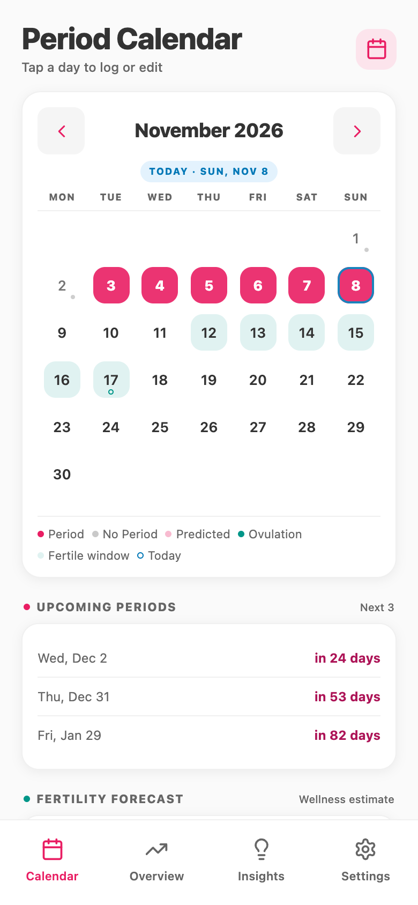
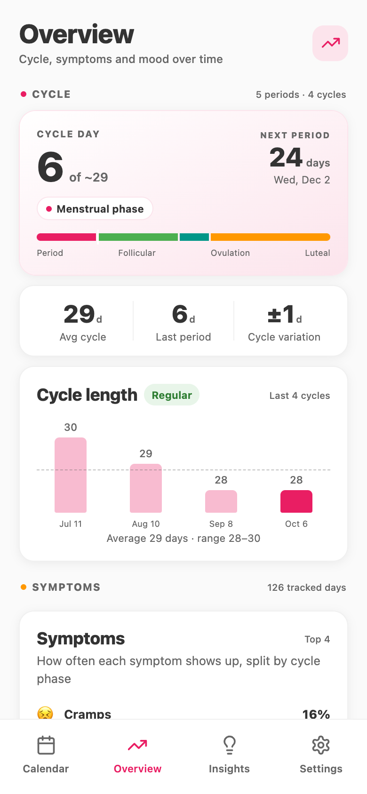
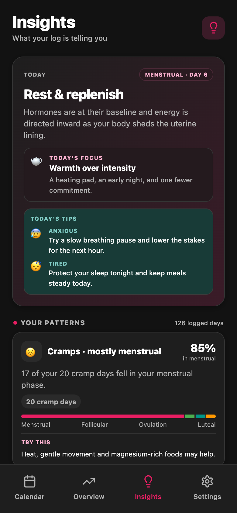

<p align="center">
  
</p>

<h1 align="center">PrivateCycle</h1>

<p align="center"><strong>Your cycle. Your business.</strong></p>

<p align="center">
  Track your period, log how you feel, and get to know your patterns.<br>
  Your history stays on your device. No account, no ads, no tracking.
</p>

<p align="center">
  <a href="https://github.com/tugcetekincan/privatecycle/releases/latest"><strong>Download for Android</strong></a>
  &nbsp; · &nbsp;
  <a href="https://github.com/tugcetekincan/privatecycle/releases">Release notes &amp; nightly builds</a>
</p>

<table>
  <tr>
    <td align="center"><strong>Your calendar</strong></td>
    <td align="center"><strong>Your patterns</strong></td>
    <td align="center"><strong>A little perspective</strong></td>
  </tr>
  <tr>
    <td></td>
    <td></td>
    <td></td>
  </tr>
</table>

<p align="center"><sub>Current development build, captured on the web with demo data. Light and dark themes included.</sub></p>

## What you can do

- **Keep a daily log.** Tap a calendar day to record your period, flow, symptoms, mood and ovulation. Pick the feelings that fit and how strongly you feel them.
- **See what's coming.** View upcoming period estimates and predicted fertile windows, based on your cycle history.
- **Make sense of your history.** Follow cycle length and variation, symptom patterns and mood trends. See how much logged data each pattern comes from.
- **Check in with yourself.** Insights brings together your current phase, tips for today and patterns from your own entries.
- **Choose your reminders.** On mobile, turn on period, logging or backup reminders, plus other optional nudges. Lock-screen wording is discreet by default.
- **Keep an intimacy log separately.** An optional private calendar sits behind its own PIN. Its entries stay out of your main calendar, insights and notifications.
- **Take your data with you.** Export a backup file and import it on another device. Automatic local backups are available on mobile.

Period and fertility forecasts are estimates. Don't use them as contraception or a diagnosis.

## Private means it stays with you

PrivateCycle has no server or account to send your history to. Your entries and cycle calculations stay on your device. Moving to another device is your choice: export a JSON backup, then import it there.

The private calendar locks when the app goes into the background. On mobile, it also blocks screenshots. Private entries are left out of backups unless you explicitly include them.

Keep an exported backup somewhere you trust. There's no cloud copy to recover if you lose your device or delete the app's data.

## Get the app

**Stable release: [v1.7.5](https://github.com/tugcetekincan/privatecycle/releases/tag/v1.7.5)** · November 5, 2026

Open the [latest release](https://github.com/tugcetekincan/privatecycle/releases/latest), download the `Privatecycle-*.apk` under **Assets**, and install it on your Android phone. The APK is built for ARM64 devices.

Want the newest changes? [Nightly builds](https://github.com/tugcetekincan/privatecycle/releases) are marked **Pre-release** and install alongside the stable app. They have their own data, so you can import a backup to try them with your history.

Android is the downloadable release. iOS and web are available to run from source; local reminders are mobile-only.

<details>
<summary><strong>Run it locally</strong></summary>

Use Node.js 22.13 or newer.

```sh
npm ci
npm run dev:web
```

Open [localhost:8082](http://localhost:8082). To explore with sample history, use [localhost:8082/?seed=1](http://localhost:8082/?seed=1); it only adds demo data when the calendar is empty.

For native builds and development checks, see [the project guide](AGENTS.md).

</details>
