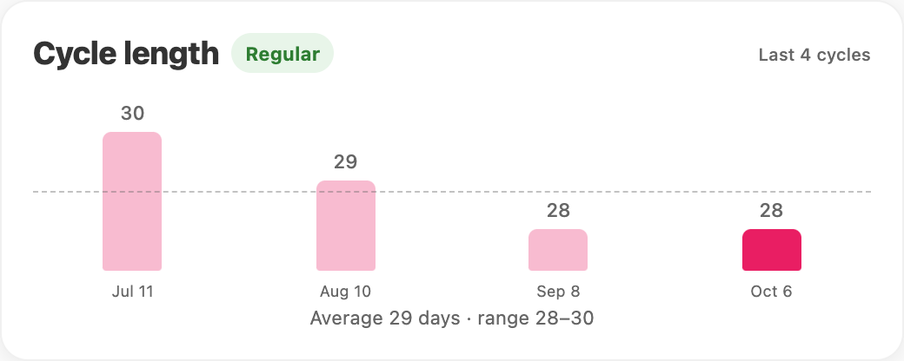
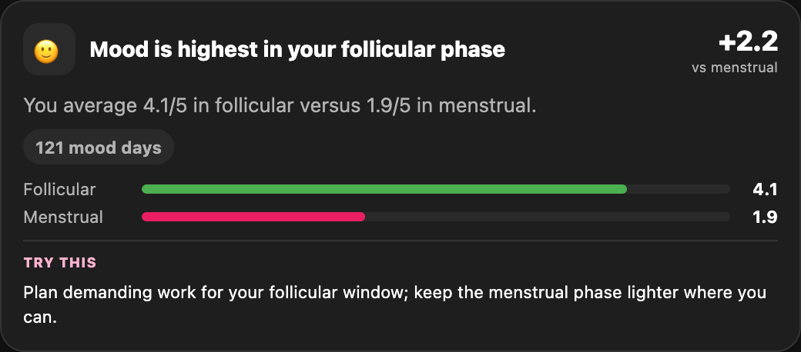
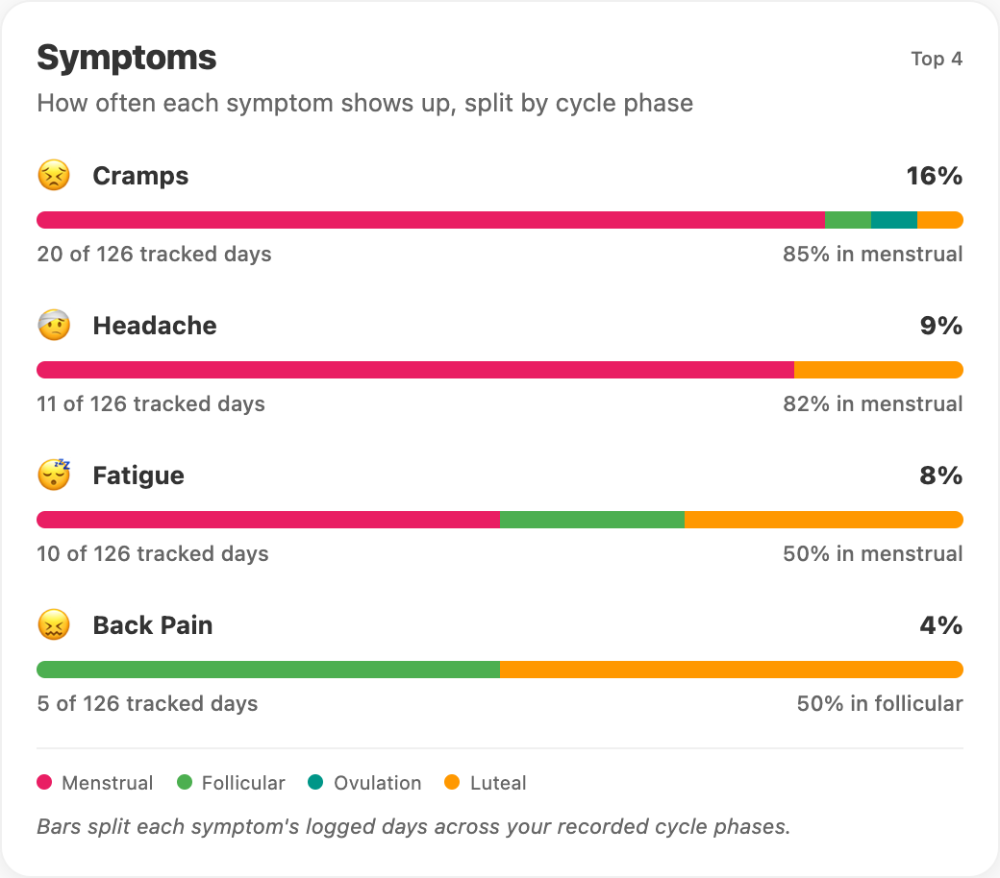
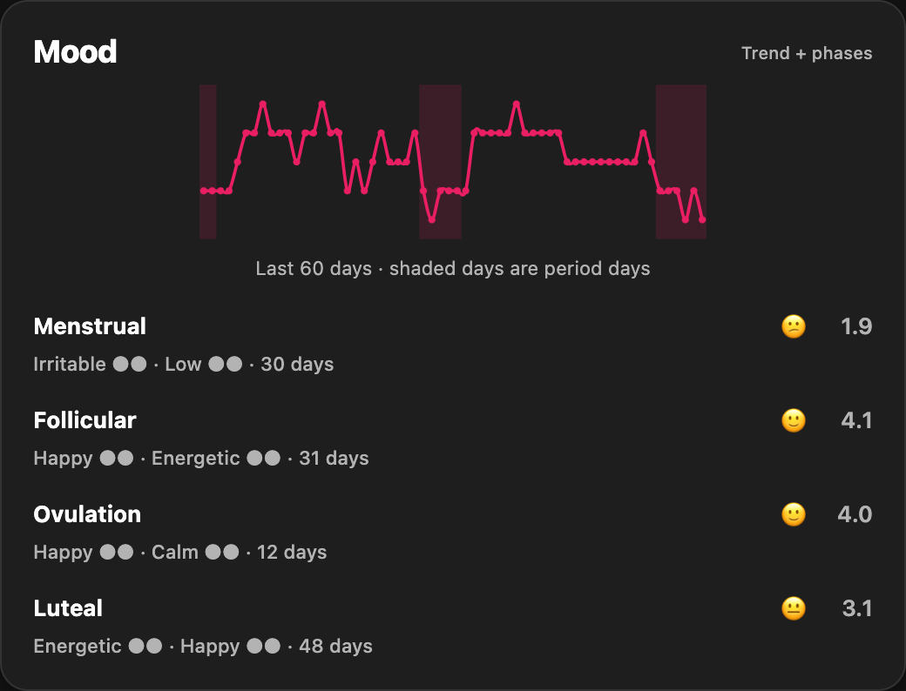

<p align="center">
  
</p>

<h1 align="center">PrivateCycle</h1>

<p align="center"><strong>Your cycle. Your business.</strong></p>

<p align="center">
  Track your period, log how you feel, and get to know your patterns.<br>
  Your history stays on your device. No account, no ads, no tracking.
</p>

<p align="center">
  <a href="https://github.com/tugcetekincan/privatecycle/releases/latest"><strong>Download for Android · v1.7.5</strong></a>
  &nbsp; · &nbsp;
  <a href="https://github.com/tugcetekincan/privatecycle/releases">Release notes &amp; nightly builds</a>
</p>

<table>
  <tr>
    <td valign="top"></td>
    <td valign="top"></td>
  </tr>
  <tr>
    <td valign="top"></td>
    <td valign="top"></td>
  </tr>
</table>

<p align="center"><sub>A closer look at Overview and Insights. Actual chart cards from the current development build, shown with demo data in light and dark mode.</sub></p>

## What you can do

- **Keep a daily log.** Tap a calendar day to record your period, flow, symptoms, mood and ovulation. Pick the feelings that fit and how strongly you feel them.
- **See what's coming.** View upcoming period estimates and predicted fertile windows, based on your cycle history.
- **Make sense of your history.** Follow cycle length and variation, symptom patterns and mood trends. See how much logged data each pattern comes from.
- **Check in with yourself.** Insights brings together your current phase, tips for today and patterns from your own entries.
- **Choose your reminders.** On mobile, turn on period, logging or backup reminders, plus other optional nudges. Lock-screen wording is discreet by default.
- **Keep an intimacy log separately.** An optional private calendar sits behind its own PIN. Its entries stay out of your main calendar, insights and notifications.
- **Take your data with you.** Export a backup file and import it on another device. Automatic local backups are available on mobile.

Period and fertility forecasts are estimates. Don't use them as contraception or a diagnosis.

## Private means it stays with you

PrivateCycle has no server or account to send your history to. Your entries and cycle calculations stay on your device. Moving to another device is your choice: export a JSON backup, then import it there.

The private calendar locks when the app goes into the background. On mobile, it also blocks screenshots. Private entries are left out of backups unless you explicitly include them.

Keep an exported backup somewhere you trust. There's no cloud copy to recover if you lose your device or delete the app's data.

<details>
<summary><strong>Run and build locally</strong></summary>

Use Node.js 22.13 or newer. Start by installing the dependencies:

```sh
npm ci
```

**Web**

```sh
npm run dev:web
```

Open [localhost:8082](http://localhost:8082). To explore with sample history, use [localhost:8082/?seed=1](http://localhost:8082/?seed=1); it only adds demo data when the calendar is empty.

To export the web app:

```sh
npm run build:web
```

The output goes to `dist/`. Your web server must send `Cross-Origin-Opener-Policy: same-origin` and `Cross-Origin-Embedder-Policy: require-corp` so local storage works.

**Android**

With the Android SDK, JDK 17 and a connected device or emulator:

```sh
npm run prebuild:android:dev
npm run android:dev
```

This builds and installs PrivateCycle Dev alongside the stable app, with its own data. Repeat prebuild after native dependency or configuration changes.

**iOS**

On macOS with Xcode installed:

```sh
npm run ios
```

This builds and launches the app in the iOS simulator. Local reminders are available on mobile only.

More device setup and verification details are in [the project guide](AGENTS.md).

</details>
